AI651 | FALL 2026

Space, Time &amp; GraphsAssignment 2

Namra NadeemRoll number: 25280097Lahore University of Management Sciences

Public code repositoryhttps://github.com/namranadeem-wq/25280097_AI651_PA2

## River forecasting and motion generalisation

Q1 proposes a causal river-network forecaster. Q2 studies whether ConvLSTM predictions transfer under reflection, rotation and faster motion, separating training-distribution effects from architectural reach.

## Experimental result

Speed augmentation reduced mean 3x two-horizon test MSE from 0.0522 (A) to 0.0333 (C). Increasing reach reduced it further to 0.0318 (D). Symmetrised D reached 0.0316 and effectively zero symmetry gaps, but retained blurred predictions and sacrificed normal-speed accuracy. Exact consistency therefore does not establish correct motion.

## Evidence and scope

All performance metrics use the prescribed 1,000 test videos. Two seeds are reported as mean (seed 0, seed 1); deterministic references have one value. Training used final weights after 30 epochs. Model D was fixed as a dilated ConvLSTM before its training; no candidate search or optional D+B training was performed.

Hardware: Tesla T4. Recorded environment: Python 3.13.16, PyTorch 2.11.0+cu130, torchvision 0.26.0+cu130. Report date: 26 October 2026.

---

# Q1 — River Forecasting Proposal

## 1. Architecture diagram

A direct one-hour forecast uses causal station histories and directed, lag-aware river messages. The diagram specifies a proposed design; no Q1 dataset or training is required.

B denotes batch size. History length 144 is 24 hours at ten-minute sampling. Eight nodes are S1-S4, T1, R1, R2 and the reservoir. Rainfall and release nodes remain distinct from level sensors; type-specific projections give a common 64-dimensional representation. Future schedules are encoded separately and joined only at the output mapping.

## 2. Assumptions

A1. Records cover at least two hydrological years with several high-flow events and stable station identities. This permits seasonal learning and chronological validation; shorter coverage would require a simpler model and wider uncertainty.

A2. Event times and arrival times can be retained. Training reconstructs the information actually available at each issuance, avoiding hindsight leakage. If arrival logs are absent, conservative fixed delays are assumed and tested.

A3. Levels share a documented datum per station, rainfall units are consistent, and reservoir releases have known units. Station-specific scaling handles different ranges; datum changes must be corrected or flagged.

A4. The main direction of useful influence is downstream. The graph encodes the supplied connectivity, but assumes upstream backwater effects are negligible at this forecast scale. Violations are a stated limitation, not a supplied fact.

---

## 2. Assumptions (continued)

A5. A 24-hour history usually contains useful rainfall, release and upstream precursors for a one-hour forecast. Travel times are unknown and condition-dependent; learned lag weights may shift with observed state. Events outside the history are unresolved.

A6. Each rainfall gauge can initially be associated with contributing river reaches using its location and an approximate catchment map. These are provisional spatial assumptions; gauge-to-station weights are learned rather than claiming an exact runoff law.

A7. Most isolated data gaps are short enough for causal carry-forward plus explicit masks and observation ages. Long outages trigger degraded forecasts and wider intervals rather than synthetic certainty.

A8. Announced releases are informative but may differ from actual operations. Archived schedule versions can be requested; where absent, the schedule branch is masked in historical training rather than reconstructed from actual future releases.

A9. The unmonitored tributary has no direct inflow observations. Historical downstream changes can partly reveal its usual effects; abrupt new inflows remain unpredictable. The system remains usable but cannot guarantee flood detection.

## 3. Forecasting task and data specification

Let t be an issuance on the ten-minute grid. Predict y(t+6) at S1-S4 directly, using observations with event time at or before t and arrival time no later than t. The history covers t-143 through t. Future release bins cover (t,t+1] through (t+5,t+6], using only schedule announcements available at t. Times in equations are grid indices; six steps equal one hour.

Input/output | Dimensions and axes | Time coverage / meaning

Water levels | B x 144 x 5 x 3 | S1-S4,T1; value/mask/age; t-143:t

Rainfall | B x 144 x 2 x 3 | R1,R2; past interval totals, mask, age; t-143:t

Actual release history | B x 144 x 1 x 3 | Past interval mean release, mask, age; t-143:t

Combined typed history | B x 144 x 8 x 3 | Sensor axis [S1,S2,S3,S4,T1,R1,R2,reservoir]

Announced release plan | B x 6 x 2 | Six future bins; planned release / known-value mask; as-of t

Static node features | 8 x F_static | Locations, sensor type, station IDs; shared across batch

Graph and edge features | 8 x 8; 8 x 8 x F_edge | Directed connectivity / reachability, river distance; rain mapping

Forecast | B x 4 x 1 | Station axis S1-S4; water level at t+6

Training target / mask | B x 4 x 1 each | Observed t+6 level; missing labels excluded from loss

Alignment uses common timestamps and explicit station identities. Aggregate rainfall to ten-minute totals and releases to interval means; level observations use the most recent eligible reading. Never interpolate from observations arriving after issuance. Short gaps use the last eligible value, but keep mask=0 and elapsed age. Standardisation statistics are fitted only on the chronological training split. Targets and uncertainty-calibration periods are held out chronologically; windows do not cross split boundaries.

---

## 4. Model computations and design justification

Let x[v,s] contain scaled value, availability and age for sensor v at historical time s. Typed projections P_type and static embedding e[v] align heterogeneous measurements; the same temporal encoder can operate on the resulting vectors.

z[v,s] = P_type(v)(x[v,s]) + e[v]
h[v,s] = GRU(z[v,s], h[v,s-1]); hidden width = 64

A causal GRU captures recent trends, levels and antecedent rainfall. Its hidden state only uses measurements eligible at the simulated issuance. The physical graph defines which sources may contribute; it does not assert fixed transport speed or conservation of water level.

score[i,v,l] = a( h[i,t], h[v,t-l], edge[i,v], lag_embed[l] )
alpha[i,v,l] = masked_softmax(score[i,v,l]), l = 0,...,143
m[i] = SUM_(v,l) alpha[i,v,l] W_type(v) h[v,t-l]
Z[i] = MLP( concat(h[i,t], m[i], e[i]) )

Mask disallowed source-station pairs before normalisation; self-history is always allowed. Sources can include all physically reachable upstream sensors, avoiding a one-edge-hop limit at S4. Time-lag attention uses archived states rather than pretending simultaneous levels are equivalent to transported signals. Distance and upstream state condition lag scores; precise travel times remain learned and unverified. Zero lag is allowed because historical hidden states already summarise earlier signals, not because instantaneous propagation is assumed.

u = MLP_schedule( flatten(schedule_as_of_t, schedule_mask) )
U[i] = W_schedule[i] u
y_hat[i,t+6] = last_available_level[i] +
               head( concat(Z[i], U[i], level_mask[i], age[i]) )

The separate six-bin schedule branch permits announced future operations without admitting future measured levels or rainfall. Station-specific schedule projections learn different reservoir-to-station responses. A missing last level uses a training median with a missingness flag; the head learns the correction. Output units are restored after scaling.

L = SUM_(b,i) target_mask[b,i] *
    (y_hat[b,i] - y[b,i])^2 / SUM_(b,i) target_mask[b,i]

Train with Adam and chronological validation in a proposed implementation; select capacity and history length without inspecting the held-out test period. Include persistence and station-wise temporal baselines. Report station-wise MAE/RMSE and high-water-event errors, because a low global MSE can hide missed floods.

Influence paths: reservoir histories and schedules can affect every main-river station; S1 warns downstream stations; monitored T1 contributes from S2 onward; S2 and S3 measurements inform downstream forecasts. Rainfall encoders contribute via provisional catchment edges. No fake node measurement is invented for the unmonitored tributary; S3/S4 histories and residual uncertainty reflect its partially observed effects. Learned weights are predictive associations, not a causal hydraulic simulator.

---

## 5. Operation and exceptional conditions

## (i) Missing observations

Use causal carry-forward for short gaps, plus mask and age. Train with realistic sensor dropout so missingness is familiar. If a station or gauge is absent for a long period, use remaining upstream sources and flag degraded service; if inputs are insufficient, issue a clearly labelled persistence fallback and a wider empirically supported interval.

## (ii) Delayed observations

Filter by arrival time at issuance. A late reading may be included in the next issuance with its true event time and age; it does not retrospectively change an issued forecast. Simulate historical delays during training and evaluation where arrival logs exist.

## (iii) Announced future releases

Use the newest schedule version announced by t, mapped by effective time into the six future bins. A later announcement is excluded even if it describes a release before t+6. Unknown schedule bins are masked and use a stated persistence plan only as a fallback assumption.

## (iv) Scheduled versus actual releases

Actual releases enter only when measured and received. Retain the schedule used for each issuance, compare it with subsequently observed operations, and calibrate forecast residuals by recent schedule reliability. Do not replace historical schedules with realised future releases. Unexpected operations remain an irreducible risk at issuance.

## Ten-minute feasibility

Only eight sensors, 144 history steps and four outputs are needed. Cache causal encoder states and update with new observations; lag aggregation at issuance is small (at most 4 x 8 x 144 source-lag combinations). Run ingestion, quality checks, inference and logging on one small service. This is a feasibility argument, not an unperformed latency benchmark; monitor the end-to-end ten-minute deadline in deployment.

## 6. Uncertainty, limitations, and additional information

Use point forecasts plus station-specific empirical residual intervals from a separate chronological calibration period. For an illustrative 90% interval, take the calibrated 90th percentile of absolute residuals and add/subtract it from the point prediction. Stratify by flow regime or input availability only where calibration support is sufficient. Coverage must be monitored: nonstationary floods and unprecedented release changes can invalidate nominal coverage.

Limitation | Forecast impact and response

Unmonitored tributary | Unexpected inflow between S2 and S3 can cause underprediction at S3/S4; retain explicit warnings and wider event-regime uncertainty. No guaranteed early warning is possible without a precursor.

Changing travel times | Fixed-lag assumptions fail as flow changes; condition lag weights on current histories and distance, recalibrate and examine event errors. Learned adaptation may still fail out of distribution.

Unseen future rain | No actual future rainfall is used. New rainfall after issuance is uncertain; use scenarios only if separately supplied and labelled.

Extreme-event scarcity / drift | High-flow accuracy may be weak despite average performance; event-focused validation, residual monitoring and periodic retraining are needed.

Backwater and physical mismatch | Directed graph omits upstream influence and detailed hydraulics; revisit edges or request a simulator if backwater is important. Levels are not conserved flows.

---

## 6. Additional information requests (continued)

Request | Why useful | Usable without it?

Arrival logs, quality flags, datum history | Reconstruct as-of inputs, realistic outages and consistent levels. | Yes, with conservative delay assumptions and stronger quality checks.

Archived release schedules and actual release logs | Train on plans genuinely known at issuance and estimate plan reliability. | Yes; mask unavailable schedule branch rather than leak realised releases.

Flow-dependent travel-time estimates; discharge and rating curves | Constrain plausible lag ranges and distinguish level changes from flow changes. | Yes; learn broad lag weights, with less physical identifiability.

Sensor on unmonitored tributary | Direct warning of inflows affecting S3/S4. | Yes, but sudden tributary floods remain unresolved.

Catchment boundaries, terrain and extra rainfall gauges | Better rain-to-station mapping and coverage of local storms. | Yes; location-based mapping is approximate.

Operational rain forecasts / radar available at issuance | Future-rain scenarios can improve storm forecasts without hindsight. | Yes; omit forecast branch if unavailable.

Flood thresholds, response costs, historical event labels | Evaluate missed warnings and false alarms, not only mean error. | Yes for forecasting, but operational alert policies need authority agreement.

The supplied facts are the sensor network, ten-minute level histories, rainfall records, release histories/plans and geographic connectivity. Record length, delay behaviour, catchment mappings, architecture width, history length and calibration procedure above are explicitly proposed assumptions or design choices.

---

# Q2 — Motion or Memory?

## Setup and reproducibility

Moving MNIST: 10,000 complete videos of 20 grayscale 64 x 64 frames, loaded with split=None. Video indices 0-7,999 train; 8,000-8,999 validation; 9,000-9,999 test. Intensities are float32 divided by 255. A/B use random normal-speed starts 1-11. C/D sample speed uniformly from {1,2,3}, then a valid start uniformly from 1-14, 1-8 or 1-2 respectively. All models output five frames; padded targets are masked. Loss averages pixels and valid horizons per video, then videos equally.

Every learned model uses Adam, learning rate 0.001, batch size 32, 30 epochs, no learning-rate schedule and final-epoch weights. Seeds control initialisation, shuffling, window and augmentation sampling. The nine-step rollout feeds back its own predictions with gradients; no true future is used as input. No normalisation, dropout or extra layers were added to A-C. D changes dilation only.

## Table 1 — Implementation checks

Check | Expected | Observed

a: M(M(x)) = x | Max difference 0; equal True | 0; True

b: R^4(x) = x | Max difference 0; equal True | 0; True

c: MRM(x) = inverse R(x) | Max difference 0; equal True | 0; True

d: mirrored marker (frame,row,col) | (7,10,43) | (7,10,43)

e: rotated marker (frame,row,col) | (7,43,10) | (7,43,10)

f: 1x input / target | 1-5 / 6-10 | 1-5 / 6-10

g: 2x input / target | 1,3,5,7,9 / 11,13,15,17,19 | Matches exactly

h: 3x input / target | 1,4,7,10,13 / 16,19 | Matches exactly

The same transform and window functions are used in training and evaluation. Marker frame indices are zero-based; forecasting frame numbers are one-based. Additional inverse-transform checks cover all eight square symmetries.

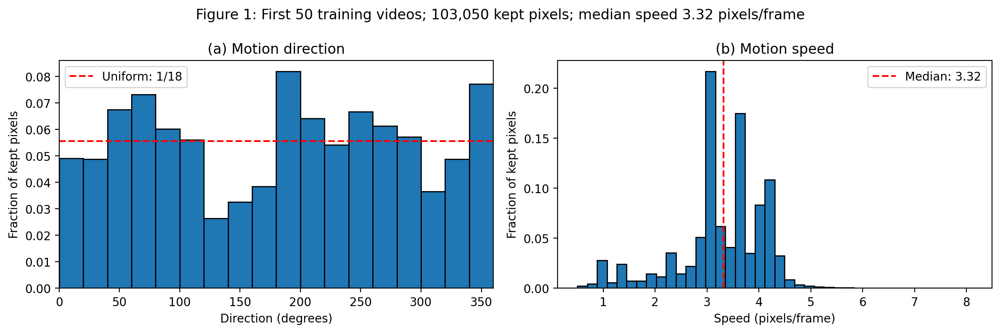

Figure 1. Prescribed Farneback flow on 950 consecutive pairs from the first 50 training videos. Kept pixels: 103,050; median speed: 3.32 pixels/frame. Both frames must exceed 0.2 intensity at the same pixel and flow magnitude must exceed 0.5. Direction histogram has 18 bins and a 1/18 reference; histograms show fractions, not counts. Settings: (0.5, 3, 15, 3, 5, 1.2, 0).

---

## Q2.1 — What the training motion distribution shows

Figure 1(a) covers all directions but is visibly nonuniform. Mirroring sends direction theta to 180 degrees minus theta (modulo 360); anticlockwise rotation adds 90 degrees. Both therefore rearrange already represented directions, though frequencies need not be preserved. Transformed trajectories are broadly familiar, not identically distributed. The median speed is 3.32 pixels/frame; rough multiples are 6.64 at 2x and 9.95 at 3x. These are scaling estimates, not direct accelerated-flow measurements: wall bounces change net displacement.

Overlap makes optical flow unreliable and foreground selection can bias which pixels survive, including favouring small displacements and some shapes/directions. Fifty videos and pooled pixels are not an unbiased census of trajectories. The broad directional coverage remains suggestive, but the exact histogram shape and speed estimates should not be treated as ground-truth object velocities; a separate non-overlap analysis would test sensitivity.

## Q2.2 — Controlled transformations

Mirror and rotation change digit appearance and transform velocity directions while preserving speed magnitudes and valid square-box bounce physics. Since directions are broadly represented, they probe sensitivity to appearance/orientation with a motion rule that remains valid. Speed-up preserves each retained frame's digit appearance but increases displacement per observed step and reduces available future targets. It probes unfamiliar speed and finite reach. The training histogram's nonuniformity makes the appearance isolation approximate rather than perfect.

## Table 2 — Baseline and references

Predictor | MSE1 | MSE2 | MSE3 | MSE4 | MSE5 | E(5) | Params

A | 0.0167 (0.0173, 0.0162) | 0.0204 (0.0211, 0.0196) | 0.0228 (0.0235, 0.0221) | 0.0246 (0.0252, 0.024) | 0.0263 (0.0268, 0.0258) | 0.0222 (0.0228, 0.0215) | 480,784

Blank | 0.0426 | 0.0426 | 0.0426 | 0.0425 | 0.0425 | 0.0426 | 0

Copy-last | 0.0492 | 0.0604 | 0.0669 | 0.0708 | 0.0732 | 0.0641 | 0

Learned entries are mean (seed 0, seed 1). All five target horizons are evaluated on 1,000 test videos at t=1, 1x. Errors have three significant figures.

## Q2.3 — Model A reach

Pixel-unshuffle maps each four-pixel grid step to one folded cell. A 3 x 3 convolution moves information by at most one folded cell along each axis. The longest within-update route is new input or previous layer-1 hidden state -> layer 1 gates -> new layer-1 hidden state -> layer 2 gates -> new layer-2 hidden state -> output. It traverses two spatial convolutions, so the maximum offset is two folded cells: 8 original pixels per axis, or 8 sqrt(2) = 11.3 pixels diagonally in Euclidean distance. A route from the previous layer-2 state crosses only one convolution. Cell-state carry and the 1 x 1 output mapping add no reach. Recurrence expands multi-step history access, not the number of convolutions in one update.

---

## Figure 2 — Baseline prediction examples

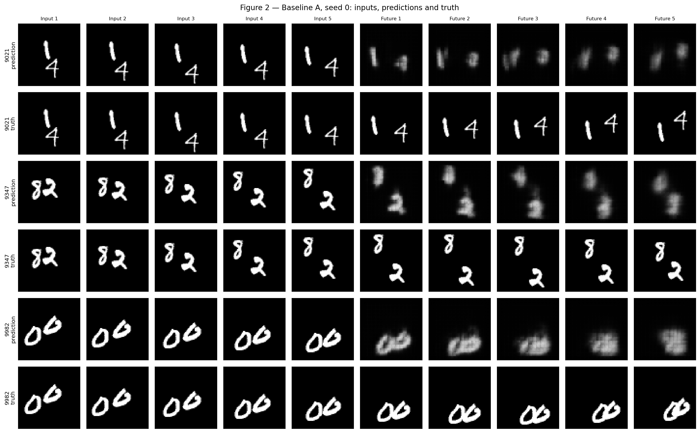

Figure 2. Model A, seed 0; test videos 9021, 9347 and 9982. Each pair shows five input frames followed by predictions / true futures. Video 9982 contains overlapping digits.

## Q2.4 — Baseline quality and overlaps

A's mean E(5)=0.0222 beats Blank (0.0426) and Copy-last (0.0641). Mean horizon error rises from 0.0167 at h=1 to 0.0263 at h=5, consistent with accumulating rollout uncertainty. In Figure 2, shapes blur and fade; for overlapping digits in video 9982, A merges their contours and loses distinct identity instead of preserving two crisp moving digits. A lower pixel MSE does not imply physically faithful object tracking.

## Q2.5 — Original predictions, preserved

Original prediction text from Q2_5_before_tests.md, committed c86d621eef at 07:08:23 UTC (12:08:23 Pakistan time), before baseline stress-test outputs recorded at approximately 07:14 UTC. Text below is retained without changing its predictions. The full file, including provenance and AI disclosure, is in the submission.

Mirror test

I predict that model A will not be exactly mirror-consistent, although it may retain some forecasting accuracy. Figure 1 shows motion in all directions, so mirrored trajectories should be broadly familiar, but the distribution is not perfectly uniform. Mirroring also changes digit appearance, and the architecture does not enforce mirror equivariance. I therefore expect a nonzero consistency gap and some increase in transformed forecasting error.

## Rotation test

I predict that model A will not be exactly rotation-consistent and that a 90-degree rotation will hurt accuracy more than mirroring. Rotated directions are broadly represented in the training data, although their frequencies differ. Rotated digit appearances are unfamiliar, and ordinary learned convolution kernels do not guarantee rotation equivariance. I expect both a nonzero consistency gap and higher transformed forecasting error.

## Faster motion

Figure 1 gives a median optical-flow speed of approximately 3.32 pixels per frame. A rough scaling gives 6.64 pixels per observed frame at 2x and 9.95 at 3x; these are estimates, not measured accelerated-video flow medians, and bounces can alter net displacement.

Model A's longest one-step path crosses two 3x3 convolutions on the folded grid. Each convolution extends reach by one folded cell, equivalent to four original pixels, giving eight pixels along either axis. Its support is a square: diagonal Euclidean reach can be larger, so eight pixels is not a universal radial speed cutoff.

I predict progressively worse forecasting at 2x and especially 3x, with possible blurring, stalled motion or disappearing digits. At 3x, some displacements may exceed the available one-step reach, depending on direction and speed. However, fast motion is also absent from training, so these tests alone will not establish whether unfamiliar motion or architectural reach causes the failure.

---

## Table 3 — Mirror and rotation tests

Predictor | E(5) | CM | EM | CR | ER

A | 0.0222 (0.0228, 0.0215) | 0.00192 (0.00181, 0.00203) | 0.0229 (0.0234, 0.0223) | 0.00317 (0.0029, 0.00343) | 0.0239 (0.0243, 0.0236)

Blank | 0.0426 | 0 | 0.0426 | 0 | 0.0426

Copy-last | 0.0641 | 0 | 0.0641 | 0 | 0.0641

## Q2.6 — Consistency is not correctness

Blank and Copy-last commute exactly with mirror/rotation but have high transformed error. Thus CT alone measures agreement under transformation, not correctness, motion quality or usefulness. Always interpret CT alongside ET. An invariantly poor predictor can have CT=0.

## Figure 3 — Largest mirror gaps

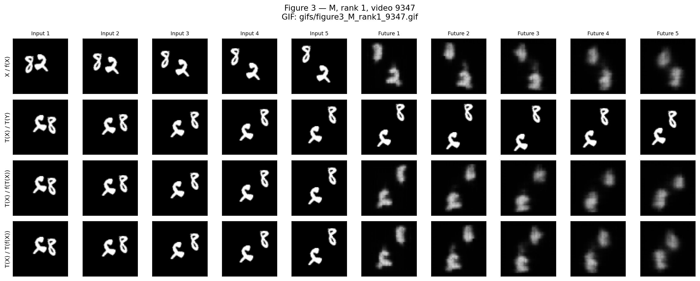

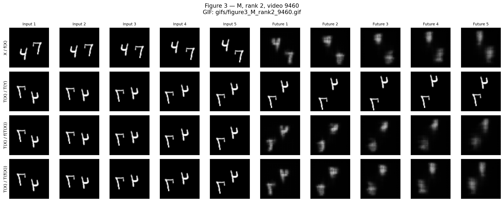

Figure 3, mirror panels. Seed-0 A; top-two per-video CM cases: 9347 and 9460. Four rows are original forecast, transformed truth, direct transformed forecast, and transformed original forecast. GIF paths: results/gifs/figure3_M_rank1_9347.gif and results/gifs/figure3_M_rank2_9460.gif. Each GIF advances the future horizon with four rows and the last input as a fixed reference.

---

## Figure 3 — Largest rotation gaps

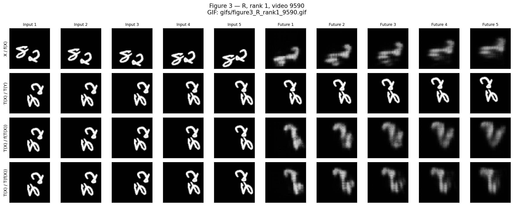

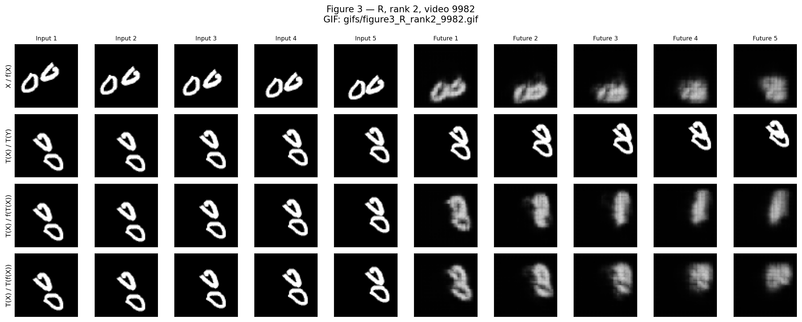

Figure 3, rotation panels. Seed-0 A; videos 9590 and 9982. GIF paths: results/gifs/figure3_R_rank1_9590.gif and results/gifs/figure3_R_rank2_9982.gif. The same four-row definition applies.

## Q2.7 — A specific disagreement

For rotated video 9982, row 2 preserves two moving loop-like digits, while both forecast rows blur them. In row 3, direct prediction from rotated input collapses the two contours into a narrow upright blob over later horizons. Row 4 retains a different, broader arrangement after rotating the original forecast. The disagreement includes contour collapse and different spatial extent; it is not merely rotating the same predicted motion. The panel does not by itself isolate a particular incorrect wall bounce.

## Q2.8 — Is rotation harder?

For A at 1x, mean CR=0.00317 exceeds CM=0.00192, and ER=0.0239 exceeds EM=0.0229. Rotation is harder on both measures. Both transformations preserve valid motion and broadly represented directions; rotation changes digit appearance more strongly. B's reduction in rotation gap supports appearance/orientation sensitivity, but nonuniform directions, pixel folding and orientation-specific kernels also matter. The result does not prove appearance is the sole cause.

---

## Figure 4 — Per-video consistency gaps

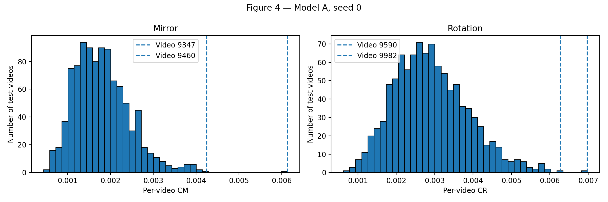

Figure 4. Seed-0 A over all 1,000 test videos. Dashed lines mark the top-two cases selected for each transformation in Figure 3. Rotation has a higher-gap distribution; selected examples are tail cases, not representative average videos.

## Table 4 — Faster-motion evaluation

Predictor | E(2), 1x | E(2), 2x | E(2), 3x | E(5), 1x | E(5), 2x

A | 0.0186 (0.0192, 0.0179) | 0.045 (0.0446, 0.0453) | 0.0522 (0.0517, 0.0526) | 0.0222 (0.0228, 0.0215) | 0.0488 (0.0481, 0.0495)

Copy-last | 0.0548 | 0.0661 | 0.0703 | 0.0641 | 0.0719

## Q2.9 — Speed failure and reach

A's mean E(2) rises from 0.0186 at 1x to 0.0450 at 2x and 0.0522 at 3x. It is already worse than Blank at 2x (0.0425) and 3x (0.0426), though still better than Copy-last. Figure 5 shows fading / blurred shapes and insufficient displacement of the lower digit at 3x; these suggest spatially uncertain, conservative extrapolation rather than reliable object tracking. The 4 becomes a blob rather than a preserved digit.

The deterioration starts before the rough median displacement exceeds the 8-pixel per-axis reach. Nominal support is an upper bound, not an effective tracking guarantee. Motion direction, faster-tail samples, phase within folded patches, bounces, unfamiliar input intervals, optimisation and repeated autoregressive errors all matter. Comparing 9.95-pixel Euclidean speed to an 8-pixel per-axis support also does not establish a hard threshold.

## Q2.10 — Separating data from reach

Baseline tests alone cannot separate unfamiliar speeds from architectural limitations. Train C with the same architecture and multi-speed data; compare with A at fixed test speeds. Then train D with larger reach but exactly the same speed sampling as C. A-to-C improvement indicates a training-distribution contribution; additional C-to-D gain is evidence consistent with reach helping, although architectural sampling and optimisation remain confounders. Use only validation for candidate architecture choices.

---

## Figure 5 — Baseline speed comparison

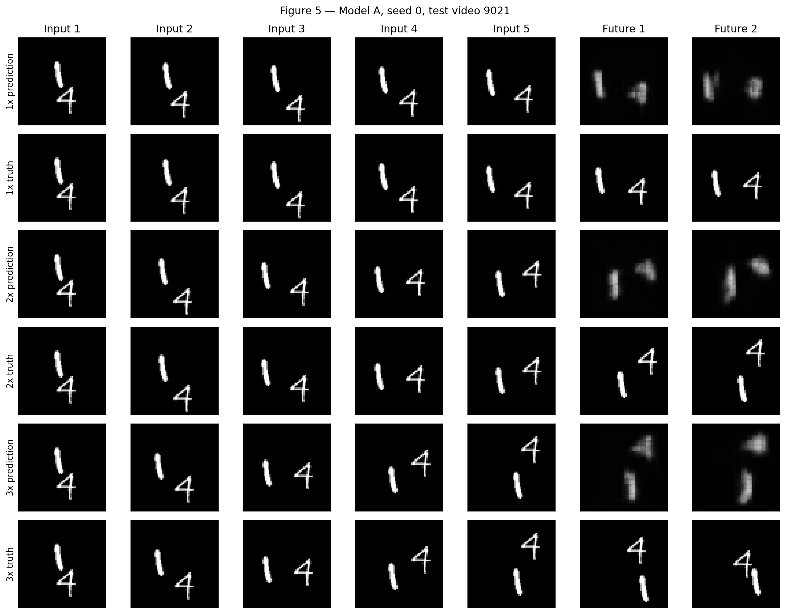

Figure 5. A, seed 0; test video 9021. For each speed, the first row contains five inputs and the first two forecasts; the next row substitutes the two true futures. Only the first two horizons permit like-for-like comparison across all speeds. The selected displayed true frames show separate digits; selection used connected-component screening followed by visual inspection.

---

## Q2.11 — Original predictions before B–D

Committed file: Q2_11_before_training_BCD.md, commit 8cff92aa88 at 07:27:03 UTC (12:27:03 Pakistan time), before B training. The three prediction sentences below are preserved unchanged.

I predict that model B's symmetry augmentation will reduce the mirror and rotation consistency gaps and improve transformed-video accuracy, but will not guarantee exact equivariance or reliably fix fast-motion failures because its reach and training speeds remain unchanged.I predict that model C's speed augmentation will improve 2x and 3x forecasting relative to A by making fast motion familiar, but its unchanged reach may limit the improvement and it may retain mirror and rotation inconsistencies.I predict that model D's larger reach, combined with the same speed augmentation as C, will further improve fast-motion tracking, especially at 3x, although neither exact symmetry nor improved accuracy is guaranteed and performance on original 1x clips may trade off against robustness.

## Table 5 — A–D: mean (seed 0, seed 1)

Metric | A | B | C | D

E(5), 1x | 0.0222 (0.0228, 0.0215) | 0.0223 (0.0225, 0.0222) | 0.0269 (0.0272, 0.0266) | 0.0286 (0.0284, 0.0287)

CM | 0.00192 (0.00181, 0.00203) | 0.00161 (0.0015, 0.00171) | 0.00119 (0.00119, 0.0012) | 0.00123 (0.00132, 0.00115)

EM | 0.0229 (0.0234, 0.0223) | 0.0223 (0.0224, 0.0221) | 0.0271 (0.0274, 0.0268) | 0.0289 (0.0287, 0.029)

CR | 0.00317 (0.0029, 0.00343) | 0.00161 (0.00152, 0.00169) | 0.00247 (0.00252, 0.00241) | 0.0024 (0.00287, 0.00193)

ER | 0.0239 (0.0243, 0.0236) | 0.0223 (0.0225, 0.0222) | 0.0281 (0.0284, 0.0278) | 0.0298 (0.0298, 0.0298)

E(2), 1x | 0.0186 (0.0192, 0.0179) | 0.0185 (0.0186, 0.0185) | 0.0232 (0.0233, 0.023) | 0.0262 (0.0259, 0.0265)

E(2), 2x | 0.045 (0.0446, 0.0453) | 0.0445 (0.0442, 0.0447) | 0.0286 (0.0287, 0.0285) | 0.0292 (0.0289, 0.0295)

E(2), 3x | 0.0522 (0.0517, 0.0526) | 0.0512 (0.0508, 0.0516) | 0.0333 (0.0334, 0.0333) | 0.0318 (0.0315, 0.0322)

Parameters | 480,784 | 480,784 | 480,784 | 480,784

Training s/epoch | 13.1 (13.1, 13.2) | 12.8 (12.8, 12.8) | 12.2 (12.2, 12.1) | 20.7 (20.7, 20.7)

Inference s/1,000 | 0.429 (0.437, 0.421) | 0.425 (0.425, 0.425) | 0.429 (0.427, 0.43) | 0.856 (0.851, 0.862)

Table 5 is transposed for readability. Every model has 480,784 parameters. Training time is mean epoch wall time over 30 epochs; one-time data download and checkpoint writes outside the measured epoch are excluded. Inference is the summed, synchronised wall time of all normal-speed test-batch predictions, batch size 32, after tensors reach the GPU; warmup and transformed-error evaluation are excluded. Hardware: Tesla T4.

## Q2.12 — Model D and its reach

D uses the same pixel folding, 64-channel two-layer ConvLSTM, 1 x 1 output and nine-step rollout as A. Both recurrent 3 x 3 gate convolutions use dilation=2 and padding=2. Each now spans offsets of two folded cells along each axis; the longest two-convolution path spans four cells, or 16 original pixels per axis (22.6 diagonally). This strictly exceeds A's 8 per-axis / 11.3 diagonal reach without increasing weights. D satisfies the 721,176-parameter cap; dilation creates sparse sampling and may worsen local reconstruction.

---

## Q2.13 — What each comparison supports

Appearance/orientation: B versus A reduces mean CR from 0.00317 to 0.00161 and ER from 0.0239 to 0.0223 at 1x, while architecture and speed remain fixed. This supports a symmetry-training contribution to orientation failures. CM also falls, but is not zero.

Unfamiliar motion: C versus A reduces 2x E(2) from 0.0450 to 0.0286 and 3x from 0.0522 to 0.0333, with unchanged architecture. Fast-motion failure was therefore not purely an absolute reach barrier.

Architectural reach: D versus C improves 3x E(2) from 0.0333 to 0.0318, about 4.54%, but worsens 2x from 0.0286 to 0.0292. This is a modest, speed-dependent gain, not evidence that C completely fails while D succeeds. Larger nominal reach is one plausible contributor; dilation changes sampling too. Training data cannot add a computational dependency outside a fixed one-step receptive support, although a recurrent model can use older states, object extent and learned motion priors, so reach should not be treated as a universal hard speed threshold.

## Q2.14 — Accuracy trade-off

At original 1x, E(5) rises from A's 0.0222 to C's 0.0269 (about 21.4%) and D's 0.0286 (29.0%). B's increase is only about 0.77%. Multi-speed training trades normal-speed specialisation for faster-motion robustness. For a service needing 1x only, A or symmetrised B is preferable on these metrics; for the assignment's robustness objective, D's 3x gain is relevant but its blur and cost must be acknowledged.

## Symmetrisation and exact equivariance

f_bar(X) = (1/8) SUM_(g in G) g^(-1) f(g X)

For any h in G, substitute k=g h. Since right multiplication permutes the group and g^(-1)=h k^(-1), the sum becomes h times the original average: f_bar(hX)=h f_bar(X). Thus CM=CR=0 in exact arithmetic for any underlying f. The implemented transform is rotate then mirror; its inverse undoes the mirror first, then the rotation. Floating-point summation explains tiny nonzero measured gaps.

## Final-model choice

The final model is symmetrised D, the required larger-reach speed-trained forecaster with group averaging. Optional D+B was not trained. Symmetrised B is retained as the specified comparison; its superior 1x accuracy does not replace the assignment's required final-model definition.

---

## Table 6 — Symmetrised models

Metric | Symmetrised B | Symmetrised D (final)

E(5), 1x | 0.0216 (0.0218, 0.0214) | 0.0284 (0.0282, 0.0286)

CM | 8.39e-17 (7.74e-17, 9.04e-17) | 5.93e-17 (5.99e-17, 5.87e-17)

EM | 0.0216 (0.0218, 0.0214) | 0.0284 (0.0282, 0.0286)

CR | 8.26e-17 (7.62e-17, 8.91e-17) | 5.88e-17 (5.99e-17, 5.77e-17)

ER | 0.0216 (0.0218, 0.0214) | 0.0284 (0.0282, 0.0286)

E(2), 1x | 0.0181 (0.0181, 0.018) | 0.0262 (0.0259, 0.0265)

E(2), 2x | 0.0437 (0.0435, 0.0439) | 0.0291 (0.0288, 0.0294)

E(2), 3x | 0.0502 (0.0499, 0.0505) | 0.0316 (0.0311, 0.032)

Parameters | 480,784 | 480,784

Training s/epoch | 12.8 (12.8, 12.8) | 20.7 (20.7, 20.7)

Inference s/1,000 | 3.62 (3.73, 3.51) | 6.89 (6.85, 6.93)

Training times belong to underlying B and D. Wrapping needs no retraining. Inference includes all eight input transformations, model passes, inverse transformations and averaging. CM and CR are in scientific notation.

## Q2.15 — Learned versus built-in symmetry

B encourages symmetry statistically, reducing gaps without making them zero. Group averaging gives exact equivariance mathematically; Table 6 gaps around 10^-17 are numerical residuals. Symmetrised B improves E(5) from B's 0.0223 to 0.0216; its original and transformed errors coincide. Symmetrised D slightly improves D's E(5) from 0.0286 to 0.0284 and 3x E(2) from 0.0318 to 0.0316.

Inference rises from B's 0.425 s to 3.62 s per 1,000 videos (8.52x), and D's 0.856 s to 6.89 s (8.05x). Averaging spatially misaligned forecasts can blur shapes and can hurt individual examples or cases where transformed inputs are poorly handled. Average reported MSE improves here, but Figure 6 remains visibly blurred; improved MSE does not guarantee sharper or more physically accurate videos.

---

## Figure 6(a) — Final model, mirror cases

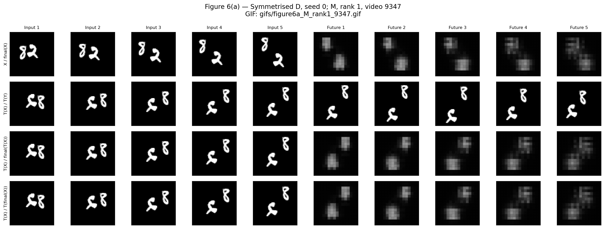

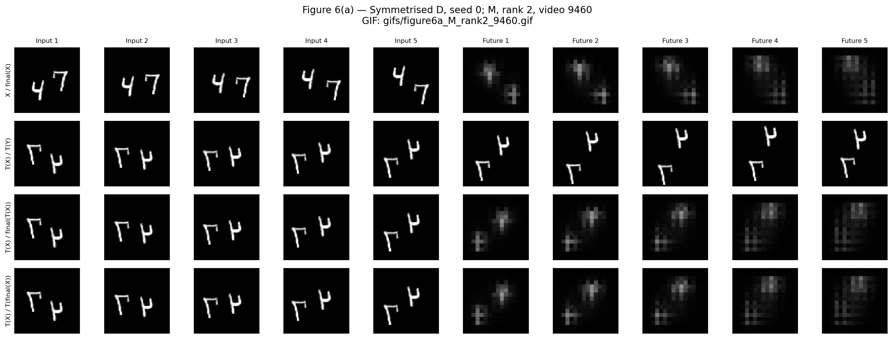

Figure 6(a), mirror. Symmetrised D, seed 0; exactly the Figure 3 videos 9347 and 9460, with the same four-row layout. The final two rows agree up to floating-point error. GIF paths: results/gifs/figure6a_M_rank1_9347.gif and results/gifs/figure6a_M_rank2_9460.gif. Consistency does not remove blur.

---

## Figure 6(a) — Final model, rotation cases

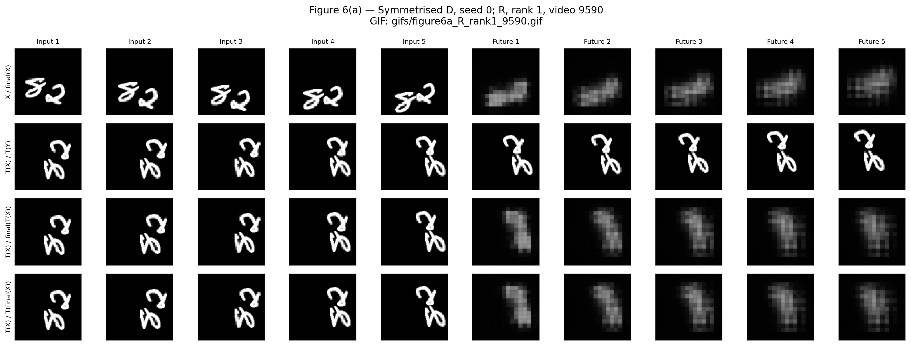

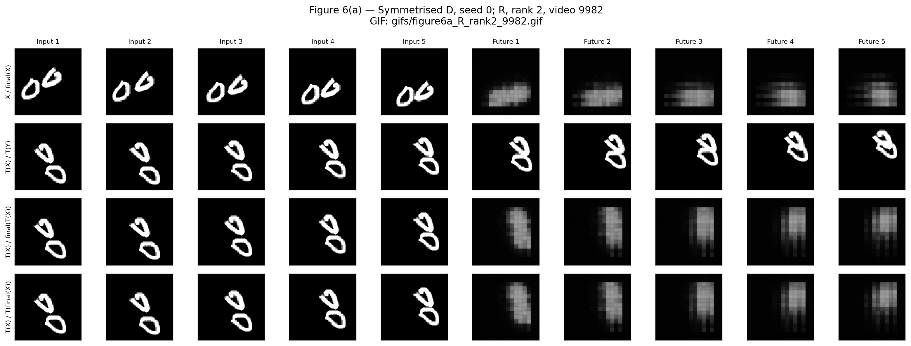

Figure 6(a), rotation. Symmetrised D, seed 0; exactly the Figure 3 videos 9590 and 9982. GIF paths: results/gifs/figure6a_R_rank1_9590.gif and results/gifs/figure6a_R_rank2_9982.gif. The group wrapper fixes disagreement between forecast orientations, not the loss of digit identity.

## Q2.16 — Return to video 9982

The final two rows now agree for rotated video 9982 (per-video consistency MSE about 1.33 x 10^-16 in the executed output). The wrapper fixes the symmetry inconsistency identified in Q2.7. However, forecasts still collapse loop-like shapes into diffuse blobs, so the final model does not fully get this example right. C/D comparisons support improved fast-motion MSE in aggregate, but they do not prove that speed training or dilation repaired this particular digit-overlap failure. The final model is more consistent, not a complete physical solution.

---

## Figure 6(b) — Final model, speed comparison

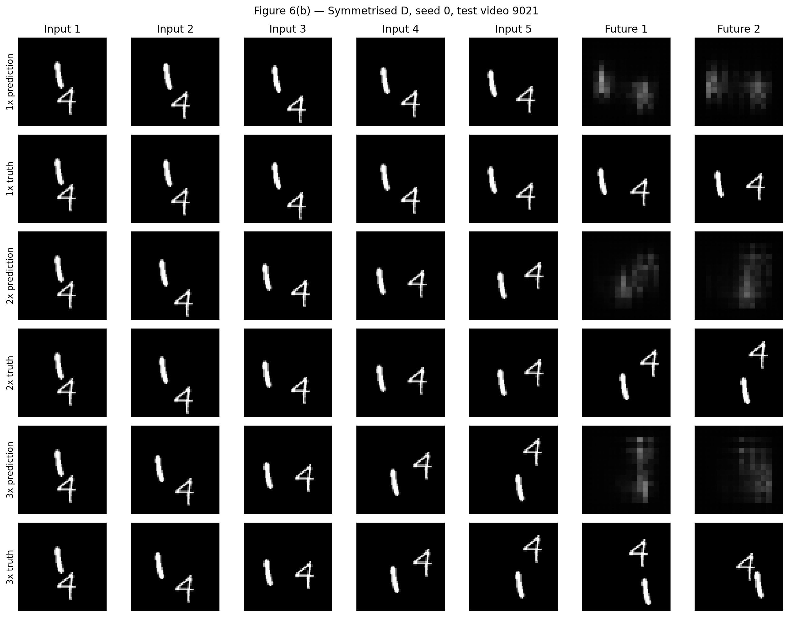

Figure 6(b). Symmetrised D, seed 0; test video 9021 and exactly the Figure 5 windows. Only the first two forecast horizons are displayed. Digit shapes remain diffuse at 1x, 2x and 3x.

## Q2.17 — Final verdict (under 150 words)

The final model learned some transferable motion information, but the evidence does not establish a complete motion rule. Speed augmentation substantially reduced 2x and 3x error, and larger reach gave an additional modest 3x gain. Group averaging made predictions exactly equivariant in theory and numerically consistent in practice. However, this symmetry is imposed by construction, not proof of learned physics. Predictions remain blurred, lose digit identity during overlap and sacrifice normal-speed accuracy. A skeptic should examine per-horizon errors, object trajectories and wall-bounce timing alongside the paired transformed-error and consistency metrics. A further test not yet passed is generalisation to unseen speeds such as 4x on longer videos, with enough future frames and separate non-overlap and bounce cases. Robust performance there would provide stronger evidence than symmetry alone.

---

# AI assistance and verification

## Use of generative AI

ChatGPT assisted with implementation of the training/evaluation notebook, plotting and export cells, prediction drafts, interpretation, the proposed Q1 architecture and preparation of this report. The user ran the notebook in Colab, supplied the resulting outputs, uploaded prediction files to GitHub and returned the executed notebook and result archive. No claim is made that the user independently authored every implementation detail or performed checks beyond the supplied evidence.

The report was assembled from the uploaded executed notebook and saved JSON/PNG/GIF files. Local review parsed every code cell, found no recorded error outputs, checked eight 30-epoch histories, cross-checked saved numerical tables and inspected rendered report pages. Training was not rerun in the report-building environment. Q1 feasibility is a proposed design, not a measured benchmark. Model checkpoints were not in the uploaded results archive; their Drive location is documented in README.

## Relevant prompts, outputs and edits

The executed notebook contains the complete generated code used for the experiments and its recorded outputs; code is also exported as a companion Python script. The following prompt/output record identifies the key assistance. Prediction drafts are preserved as separate Markdown files. This appendix records the available conversation excerpts; it is not represented as a full platform chat export.

User prompt (verbatim) | Assistant output / resulting artifact | Edits and execution evidence

start with the assignment | 25280097_AI651_PA2_start.ipynb: data windows, ConvLSTM A-D, checks, checkpointed training and Table 2 evaluator. | User executed in Colab; selected T4; mounted Drive. Subsequent supplied cells were appended.

give me the md file that i can upload on github | Q2_5_before_tests.md; full prediction output preserved in the submitted file. | File committed before baseline stress-test results; no rewrite of predictions in this report.

Repository link supplied after Q2.5 upload | baseline_stress_tests(): original/transformed and 1x/2x/3x metrics, per-video arrays. Full code and output in notebook. | Both seeds executed and results exported.

what to do now | Figure 3/4 code selecting largest seed-0 gaps and producing panels/GIFs. | User appended and executed. GIFs use last input as fixed reference beside each future.

Screenshots supplied; then start with b-d training | Figure 5 code and Q2_11_before_training_BCD.md; B-D training invocation. | Prediction file committed before training; all six runs reached epoch 30.

Training-log upload | evaluate_model() and symmetrised_predict(): Tables 5/6, timings and wrapper evaluation. | All 12 model/seed evaluations completed.

give code | Figure 6 code using symmetrised D and the same saved video IDs. | User executed and returned screenshots.

Figure 6 screenshots supplied | Figure 2 code; results ZIP export instructions. | User executed and uploaded results archive plus notebook.

Results archive and executed notebook uploaded | This report, README, source export, result tables and packaged submission. | Formatting, explanations and packaging created from recorded results; no extra training or fabricated metrics.

---

## Exact short output excerpts

Prompt: "give me the md file that i can upload on github"

Output excerpt: "Review the predictions, then on GitHub choose Add file -&gt; Upload files, upload it and click Commit changes." The complete substantive prediction text is preserved in Q2_5_before_tests.md and the Q2.5 section.

Prompt: "give code"

Output excerpt: "It saves Figure 6(a), its GIFs, and Figure 6(b) using symmetrised D on the same videos as before." The full accompanying code and executed outputs are in the notebook.

Observed output: "Parameter count, output shape and backward checks passed."

Observed output: "D seed 1 | 30/30 | MSE 0.030406 | 20.8s/epoch | this run ~0.0 min left"

Observed output: "Completed sym_D, seed 1"

Observed Figure 1 statistics: {"frame_pairs": 950, "kept_pixels": 103050, "median_speed": 3.317502498626709}

## Files that preserve the generated outputs

25280097_AI651_PA2_executed.ipynb retains the supplied code, execution counts, text results and embedded figures. experiment_code.py exports code cells in their notebook order; follow the staged notebook workflow rather than invoking it as an unattended script, because prediction-commit milestones occur between stages. Q2_5_before_tests.md and Q2_11_before_training_BCD.md retain the prediction drafts. results/ contains all exported tables, training histories, figure panels and eight animated GIFs.

## References

Assignment 2 handout, AI651 - Deep Learning for Space, Time and Graphs, LUMS, Fall 2026. Dataset split, architecture, evaluation and reporting protocols follow this handout.

Shi, X. et al. (2015). Convolutional LSTM Network: A Machine Learning Approach for Precipitation Nowcasting. NeurIPS. The experiment implements the handout's no-peephole variant.

Srivastava, N., Mansimov, E., and Salakhutdinov, R. (2015). Unsupervised Learning of Video Representations using LSTMs. ICML. Moving MNIST is accessed through torchvision as prescribed.